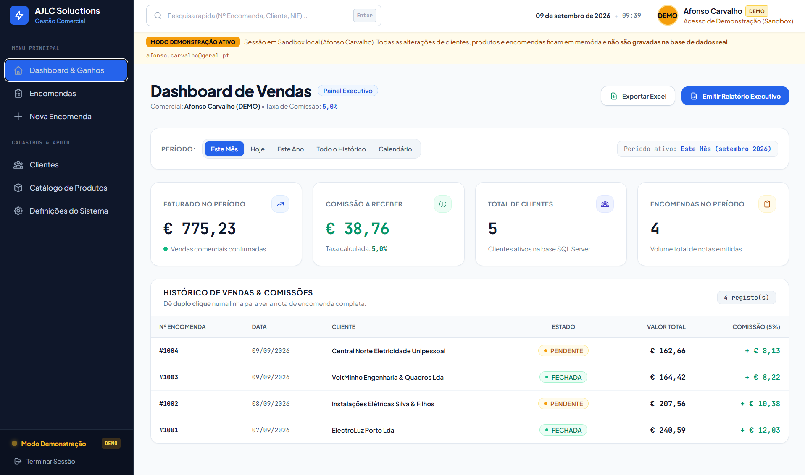
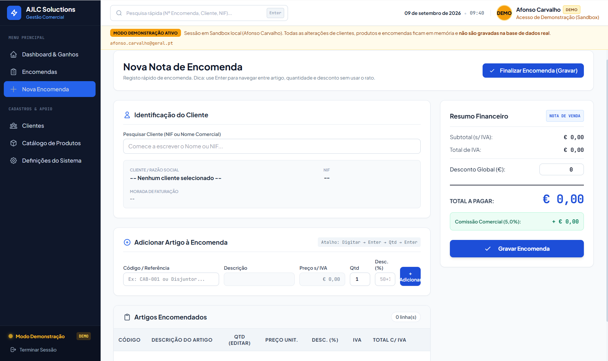
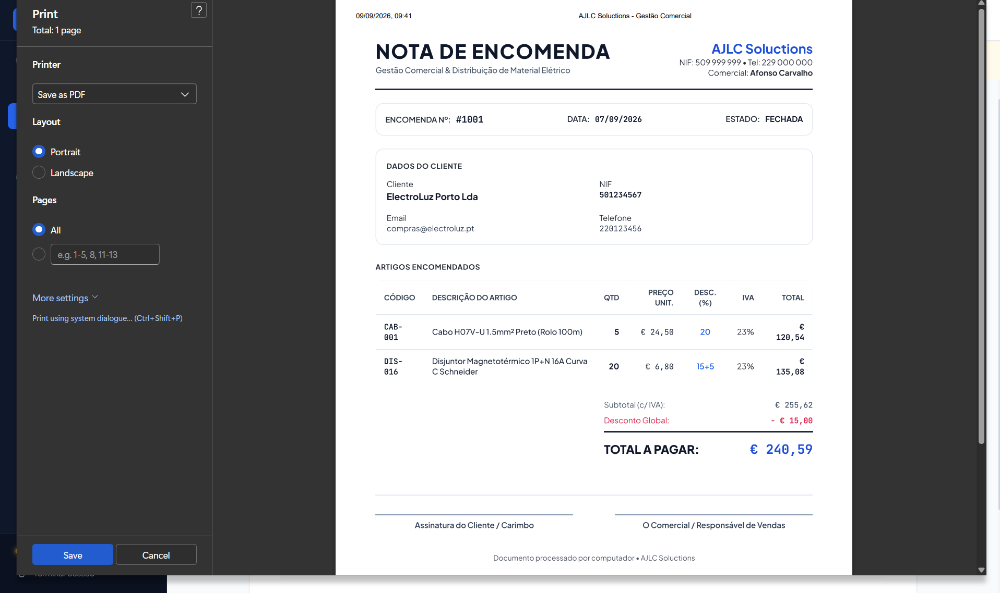
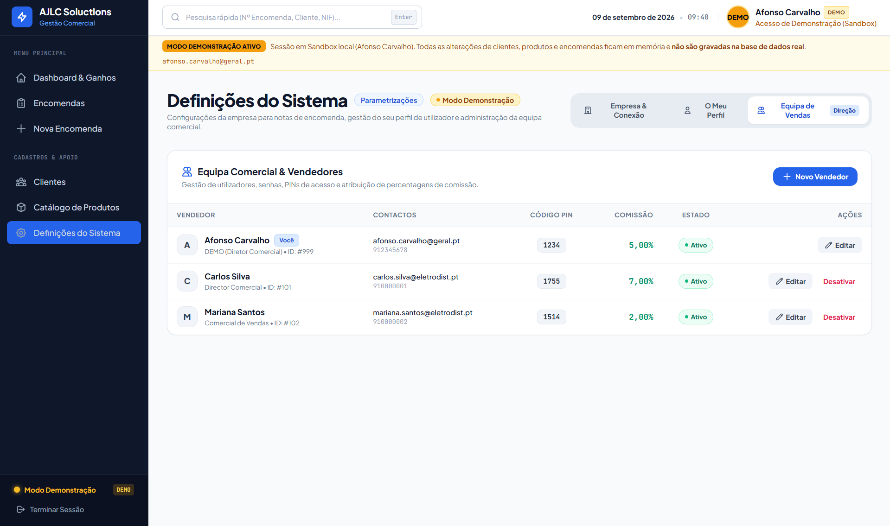
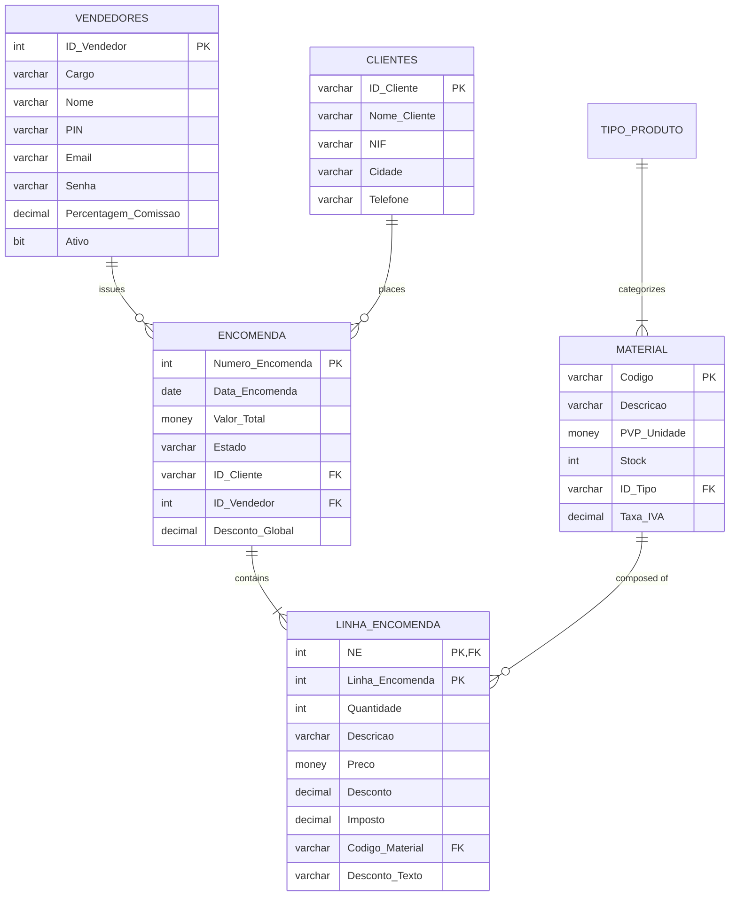

# 💼 Commercial Sales Manager

[](https://dotnet.microsoft.com/)
[](https://docs.microsoft.com/dotnet/csharp/)
[](https://learn.microsoft.com/aspnet/core/blazor/hybrid/)
[](https://tailwindcss.com/)
[](https://www.microsoft.com/sql-server/)
[](LICENSE)

A hybrid desktop application (**C# .NET 8**, **Windows Forms**, and **Blazor WebView**) designed to digitize field order taking for commercial representatives in B2B distribution and technical wholesale.

> [!NOTE]
> **Localization:** The UI is localized in **European Portuguese (pt-PT)** to align with Portuguese B2B commercial practices, tax rules (IVA), and invoicing conventions.

---

## 📖 The Problem & Practical Solution

In technical B2B wholesale (such as electrical material and industrial supplies), field sales representatives frequently record client orders manually on paper carbon pads. Orders are then sent back to headquarters by photographing the paper slip or sending a fax.

This introduces common operational pain points:
* **Transcription Errors & Delays:** Handwritten item codes can be misread at the warehouse.
* **Complex Tiered Discounts:** Calculating cascading supplier discounts (e.g. `50+10`, `40+5+2.5%`) on a pocket calculator leads to frequent pricing discrepancies.
* **Commission Tracking:** Reps and managers spend time manually compiling notes to calculate earned commissions.
* **No Real-Time Stock Visibility:** Difficult to check warehouse inventory while negotiating on-site.

**Commercial Sales Manager** addresses these issues with a direct, focused tool:
* **Fast Order Entry:** Rapid client search by NIF, company name, phone, or city.
* **Cascading Discount Engine:** Computes compounding supplier discount tiers and VAT automatically.
* **Standard A4 Order Documents:** Generates clean, itemized order sheets ready to print or export to PDF with signature blocks.
* **Consistent Transactions:** Deducts stock and saves order headers and detail lines inside atomic SQL Server transactions.
* **Offline Demo Mode:** Includes a built-in in-memory demonstration mode with mock data for testing when disconnected from the central database.

---

## 🏗️ Architecture

The application uses a **Hybrid Desktop Architecture (.NET 8 + Blazor WebView)**:

```text
┌─────────────────────────────────────────────────────────────┐
│               Windows Forms Shell Host                      │
│               (FormMenu.cs hosting BlazorWebView)           │
├─────────────────────────────────────────────────────────────┤
│         Blazor WebView Components (HTML5 / Tailwind CSS)    │
│  ├── Dashboard.razor       ├── Clientes.razor               │
│  ├── NovaVenda.razor       ├── Produtos.razor               │
│  ├── Encomendas.razor      ├── Definicoes.razor             │
│  └── DetalhesEncomenda.razor                                │
├─────────────────────────────────────────────────────────────┤
│                    C# Business Logic Layer                  │
│  ├── Sessao.cs (Authentication & User Session)              │
│  ├── ConfiguracaoEmpresa.cs (JSON Company Settings)         │
│  └── DatabaseConfig.cs (SQL Server Connection Manager)      │
├──────────────────────────────┬──────────────────────────────┤
│    Online Mode (SQL Server)  │   Offline Mode (Demo Sandbox)│
│    Microsoft.Data.SqlClient  │   DadosDemonstracao.cs       │
│    Microsoft SQL Server      │   In-Memory Mock Repository  │
└──────────────────────────────┴──────────────────────────────┘
```

---

## 📸 Screenshots

### 1. Sales Dashboard
Period revenue tracking, order counts, and estimated commissions based on representative contract rate.


### 2. Order Entry & Cascading Discounts
Customer lookup, product autocomplete, and instant calculation of compounding B2B discount tiers (e.g. `50+10`).


### 3. A4 Order Document (Print & PDF)
Standardized A4 order sheet with company header, client dossier, itemized lines, VAT breakdown, and signature block.


### 4. Sales Team & Settings
Management of sales representatives, PIN credentials, and contractual commission rates.


---

## ✨ Features

* **Dual Authentication:**
  * **Quick 4-digit PIN:** Convenient for field tablets and rapid logins between client visits.
  * **Email & Password:** Standard login supporting Sales Representative, Commercial Director, and Admin roles.
* **Compounding Discount Calculation:** Handles supplier trade discounts structured in tiers (e.g. `50+10`, `40+5+2.5%`) alongside global order discounts and standard VAT rates.
* **Atomic Order Processing:** In SQL Server mode, order insertion and inventory deduction execute within an atomic `SqlTransaction` with rollback protection.
* **Print & PDF Export:** Renders an A4 order sheet suitable for direct physical printing or export to Microsoft Print to PDF.
* **Product Catalog & Stock Adjustments:** Search by code or description, with stock adjustments restricted to authorized accounts.
* **Configurable Company Profile (`empresa_config.json`):** Customizable company header (name, NIF, address, contact information) that updates order documents without recompiling.

---

## 🗄️ Database Schema (SQL Server)



---

## 🚀 Getting Started

### Prerequisites
* [.NET 8.0 SDK](https://dotnet.microsoft.com/download/dotnet/8.0)
* Windows OS (required for Windows Forms runtime)
* [Visual Studio 2022](https://visualstudio.microsoft.com/) (with *.NET Desktop Development* workload) or VS Code
* *(Optional)* Microsoft SQL Server (LocalDB, Express, or Developer)

### 1. Clone the repository
```bash
git clone https://github.com/Afonsojlc/commercial-sales-manager.git
cd commercial-sales-manager
```

### 2. Database Setup (Optional)
If you have SQL Server running locally:
1. Execute [`database/database_schema.sql`](database/database_schema.sql) in SQL Server to create the `CommercialSalesDB` database and tables.
2. Execute [`database/database_seed.sql`](database/database_seed.sql) to load sample clients, materials, and users.

> If SQL Server is not detected or offline, the application automatically enables **Offline Demonstration Mode** with built-in mock data.

### 3. Build & Run
```bash
# Build solution
dotnet build SoftwareVendas/SoftwareVendas.sln

# Run application
dotnet run --project SoftwareVendas/SoftwareVendas/SoftwareVendas.csproj
```

### 4. Demo Login Credentials

#### Connected Mode (SQL Server):
* **Commercial Director:** `carlos.silva@eletrodist.pt` | Password: `Paredes10` | PIN: `1755`
* **Sales Representative:** `mariana.santos@eletrodist.pt` | Password: `Paredes11` | PIN: `1514`

#### Offline Demo Mode (In-Memory):
* Click **"Entrar em Modo Demonstração (Sandbox)"** on the login screen.
* Pre-set Profile: **Afonso Carvalho** (DEMO) | PIN: `1234`

---

## 📁 Project Structure

```text
commercial-sales-manager/
├── database/                            # SQL Server scripts (schema, seed, verify)
├── docs/                                # Diagrams and screenshots
├── README.md
└── SoftwareVendas/
    ├── SoftwareVendas.sln
    └── SoftwareVendas/
        ├── FormMenu.cs                  # WinForms shell hosting BlazorWebView
        ├── DatabaseConfig.cs            # Connection manager
        ├── Sessao.cs                    # Session state and permissions
        ├── ConfiguracaoEmpresa.cs       # Company settings profile manager
        ├── DadosDemonstracao.cs         # In-memory mock repository for demo mode
        ├── Components/
        │   ├── Layout/                  # Navigation sidebar & layout
        │   └── Pages/                   # Razor views (Dashboard, NovaVenda, etc.)
        └── wwwroot/                     # Styles, Tailwind CSS, and print media rules
```

---

## 👤 Author

**Afonso Carvalho**  
* GitHub: [@Afonsojlc](https://github.com/Afonsojlc)  
* LinkedIn: [Afonso Carvalho](https://www.linkedin.com/in/afonso-carvalho-64796328a/)

---

## 📄 License

This project is licensed under the [MIT License](LICENSE).
